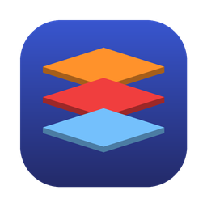

<div align="center">



# MidDeck

**One deck for all your middleware.**
Kafka · Redis · RabbitMQ — through bastion hosts, with a real GUI, and AI assistance on the way.

[](https://github.com/YunMuZhe/MidDeck/actions/workflows/build.yml)
[](https://github.com/YunMuZhe/MidDeck/releases)
[](LICENSE)


[简体中文](README.md) | English

</div>

---

## Why

- Creating a Kafka topic or RabbitMQ queue during a release means typing CLI commands, again.
- Checking data after a deploy means SSH-ing into a bastion host and typing more commands.
- Existing tools cover one middleware, can't reach clusters behind jump hosts, or are just clunky.

MidDeck is a cross-platform desktop client for everyday middleware operations, and it takes **"I can't connect"** seriously.

## Features

### Connectivity
- **Multi-hop SSH jump hosts + SOCKS5 proxy** (password, private key, ssh-agent). Every connection is dialed from the last hop.
- **Kafka behind NAT just works**: brokers advertising internal addresses are reachable through the tunnel; address rewriting is available too.
- **Layered diagnostics**: SSH → TCP → TLS → auth → broker reachability → version → permissions, with a concrete hint for each failure.
- **Version compatibility check**: server version is detected on connect, with warnings for unsupported versions or unavailable features ([matrix](docs/COMPATIBILITY.md)).

### Configuration
- Organize by **project → environment → instance**, with aliases, tags and fuzzy search.
- Passwords live in the OS keychain (macOS Keychain / Windows Credential Manager), never in the config file.
- **Import / export** for sharing with teammates: secrets are stripped by default, or bundled with passphrase encryption (AES-256-GCM).

### Kafka
- Topics: list, details (partitions / ISR / offsets / configs), create, delete, add partitions, alter configs.
- Messages: newest / oldest / from offset / from timestamp, key and content filters, JSON pretty print, JSONL export, produce with headers and explicit partition.
- Consumer groups: lag overview and per-partition detail, **offset reset with a dry-run preview**, delete.

### Redis
- Standalone / cluster / sentinel; key browsing uses `SCAN`, never `KEYS`.
- View string / hash / list / set / zset / stream, edit strings, manage TTL, bulk delete.
- Console with history and confirmation for dangerous commands.
- INFO overview and slow log; detects commands disabled through `rename-command`.
- Detects Valkey / Dragonfly / KeyDB.

### RabbitMQ
- Queues and exchanges; create queues (classic / quorum / stream, with DLX, TTL and binding in one step).
- Peek messages (requeue mode), publish, purge, delete.
- Export vhost definitions.

### Interface
- English / Chinese (English by default); light, dark or follow-system theme
- Home overview and per-instance stat tiles (topics, lag, memory, ready messages…)

### Safety
- Production instances are clearly marked; destructive actions require typing the resource name.
- Per-instance **read-only mode**.
- Every write is recorded in a local **audit log**.
- Forms show the **equivalent CLI command**, ready to copy.

## Install

Download from [Releases](https://github.com/YunMuZhe/MidDeck/releases):

| Platform | File |
|---|---|
| macOS (Intel + Apple Silicon) | `MidDeck-*-macos-universal.dmg` |
| Windows x64 / ARM64 | `MidDeck-*-windows-*-setup.exe`, or the portable `*-portable.exe` |
| Linux x64 | `MidDeck-*-linux-amd64.tar.gz` (requires `libwebkit2gtk-4.1`) |

> Builds are not code-signed yet. See [docs/INSTALL.md](docs/INSTALL.md) for getting past the macOS / Windows warning.

## Roadmap

- [x] Connection management, SSH tunnels, layered diagnostics, version compatibility
- [x] Kafka / Redis / RabbitMQ essentials
- [ ] **Changesets**: describe topics / queues in YAML, plan → apply, promote across environments, CLI for CI
- [ ] **Skip & replay**: export stuck messages → move offsets → replay after the fix (tagged with replay headers)
- [ ] **AI assistant**: OpenAI-compatible and Anthropic APIs; locate an instance from one sentence and prefill the form (it only prefills, a human confirms)
- [ ] MCP server for Claude Code / Cursor
- [ ] Agent mode for bastions that forbid port forwarding
- [ ] More middleware: RocketMQ, Pulsar, Elasticsearch, ZooKeeper, Nacos

## Build from source

Requires Go 1.26+, Node.js 20+ and [Wails v2](https://wails.io/docs/gettingstarted/installation).

```bash
go install github.com/wailsapp/wails/v2/cmd/wails@latest
wails dev      # dev mode with hot reload
wails build    # output in build/bin/
```

## Contributing

See [CONTRIBUTING.md](CONTRIBUTING.md).

## License

[MIT](LICENSE)
