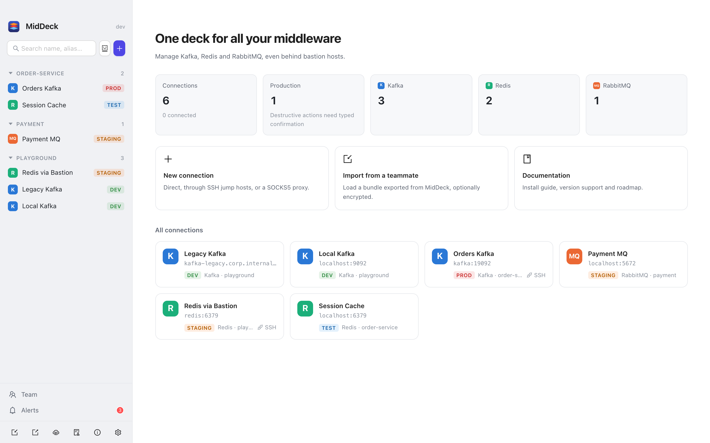
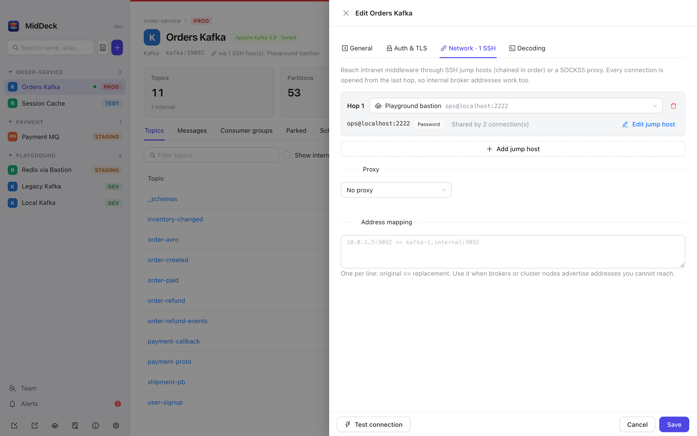
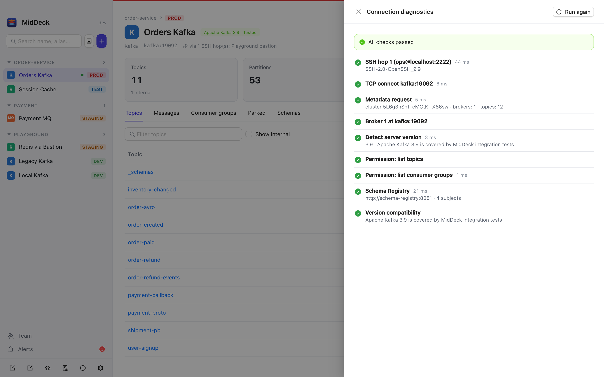
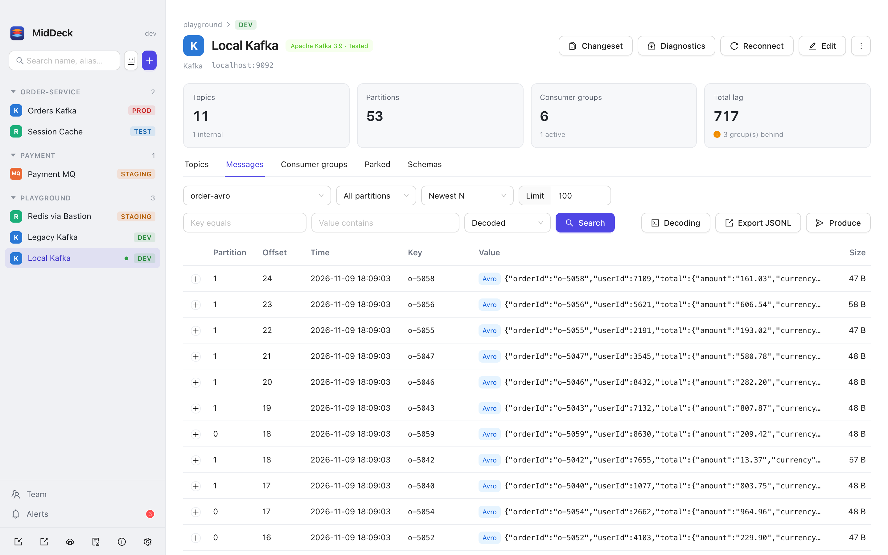
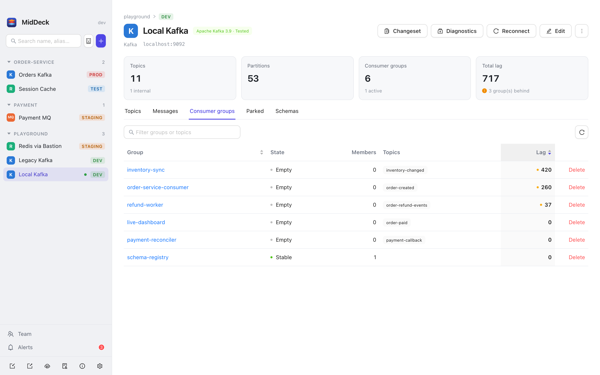
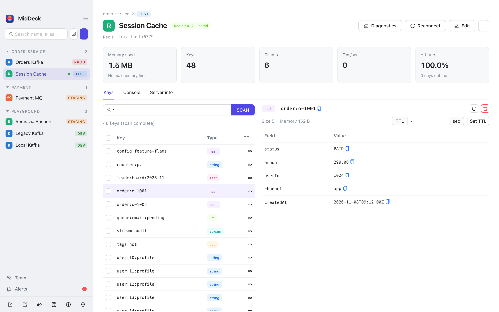
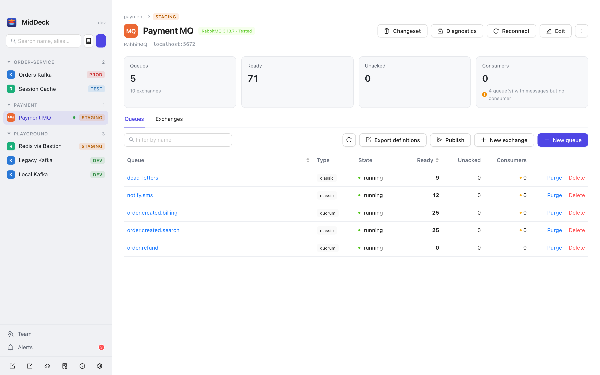
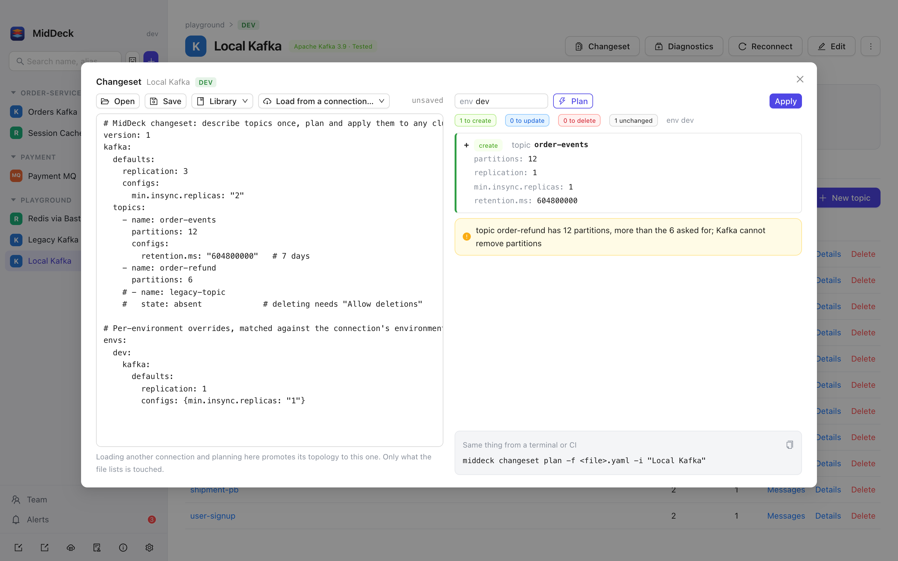
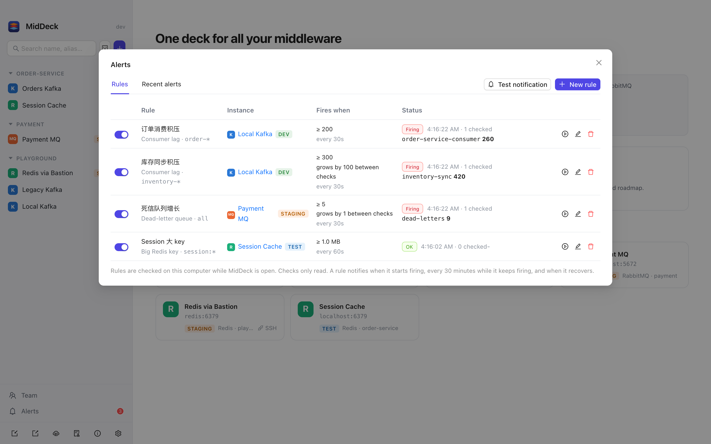

<div align="center">


# MidDeck

**One deck for all your middleware.**
Kafka · Redis · RabbitMQ — through bastion hosts, with a real GUI and an AI assistant.

[](https://github.com/YunMuZhe/MidDeck/actions/workflows/build.yml)
[](https://github.com/YunMuZhe/MidDeck/releases)
[](LICENSE)


[简体中文](README.md) | English

</div>

---

## Why

- Creating a Kafka topic or RabbitMQ queue during a release means typing CLI commands, again.
- Checking data after a deploy means SSH-ing into a bastion host and typing more commands.
- Existing tools cover one middleware, can't reach clusters behind jump hosts, or are just clunky.

MidDeck is a cross-platform desktop client for everyday middleware operations, and it takes **"I can't connect"** seriously.



## Features

### Connectivity
- **Multi-hop SSH jump hosts + SOCKS5 proxy** (password, private key, ssh-agent). Every connection is dialed from the last hop.
- **Shared jump hosts**: maintain bastions in one place and pick them (or create one on the spot) when adding a connection; edit once, every connection follows.
- **Kafka behind NAT just works**: brokers advertising internal addresses are reachable through the tunnel; address rewriting is available too.
- **Layered diagnostics**: SSH → TCP → TLS → auth → broker reachability → version → permissions, with a concrete hint for each failure.
- **Version compatibility check**: server version is detected on connect, with warnings for unsupported versions or unavailable features ([matrix](docs/COMPATIBILITY.md)).

<p>
  
  
</p>

### Configuration
- Organize by **project → environment → instance**, with aliases, tags and fuzzy search.
- Passwords live in the OS keychain (macOS Keychain / Windows Credential Manager), never in the config file.
- **Import / export** for sharing with teammates: secrets are stripped by default, or bundled with passphrase encryption (AES-256-GCM).

### Kafka
- Topics: list, details (partitions / ISR / offsets / configs), create, delete, add partitions, alter configs.
- Messages: newest / oldest / from offset / from timestamp, key and content filters, JSON pretty print, JSONL export, produce with headers and explicit partition.
- **Message decoding**: Schema Registry (Confluent wire format) Avro / Protobuf / JSON Schema messages are decoded to JSON automatically, references included. Plain Protobuf topics decode with local `.proto` files bound per topic; other binary payloads show as base64. Filters, skip previews, parked messages and MCP all see the decoded text. The registry is reached through the same jump hosts / proxy as Kafka, and has a read-only schema browser.
- Consumer groups: lag overview and per-partition detail, **offset reset with a dry-run preview**, delete.
- **Skip & replay**: save the messages a group is stuck on, move its offsets past them, and replay them after the fix, to the original topic, a retry topic or another cluster. Every replayed message carries `x-middeck-replay` and related headers.

<p>
  
  
</p>

### Redis
- Standalone / cluster / sentinel; key browsing uses `SCAN`, never `KEYS`.
- View string / hash / list / set / zset / stream, edit strings, manage TTL, bulk delete.
- Console with history and confirmation for dangerous commands.
- INFO overview and slow log; detects commands disabled through `rename-command`.
- Detects Valkey / Dragonfly / KeyDB.



### RabbitMQ
- Queues and exchanges; create queues (classic / quorum / stream, with DLX, TTL and binding in one step).
- Peek messages (requeue mode), publish, purge, delete.
- Export vhost definitions.



### Changesets (Kafka / RabbitMQ)
- Describe topics, exchanges, queues and bindings in YAML. **Plan** shows the difference and **apply** runs it. Only what the file lists is touched, and deletions are opt-in.
- Export any connection and plan against another to **promote across environments**. `envs` overrides replication, partitions and configs per environment.
- The same binary is the CLI: `MidDeck changeset plan|apply|export`, ready for CI. See [docs/CHANGESETS.md](docs/CHANGESETS.md).



### AI assistant (⌘K / Ctrl+K)
- One sentence finds the instance and opens the right form, prefilled: "create topic order-refund on the prod orders Kafka, 12 partitions, keep 7 days".
- **Anthropic** (default `claude-opus-5-5`) or any **OpenAI-compatible** endpoint (OpenAI, DeepSeek, Qwen, Ollama…).
- **Prefill only**: nothing runs until you confirm in the form. The model sees names, projects, environments, tags, aliases and descriptions, never passwords.
- It can also **draft changeset YAML**, opened in the changeset editor for you to plan and apply.

### MCP server
- `MidDeck mcp` serves your connections to Claude Code and Cursor: topics, consumer lag, messages, Redis keys, RabbitMQ queues.
- Reuses saved connections, jump hosts and keychain credentials. It **never changes your middleware**; changes stay in the app.
- Exports, writes and dry-runs changeset YAML and saves it to the changeset library, for a person to plan and apply in MidDeck.
- **Manage connections** too: `instance_create / update / delete` and `bastion_*`; secrets are never returned.
- Setup: Settings (bottom left) → "Use in Claude Code / Cursor (MCP)", or see [docs/MCP.md](docs/MCP.md).

### Linux servers (headless)
- One static binary (amd64 / arm64) with **no desktop, GTK or WebKit** needed, for any distribution: `middeck mcp`.
- **Loads connections from a Git repository** (e.g. self-hosted GitLab): `middeck mcp --repo <url>` clones it at start and pulls every 5 minutes; connections removed from the repository are removed here, ones added on the server are kept.
- Passwords stay out of the repository: set them on the server through MCP; they are kept in a local 0600 file.
- Use it from your laptop over SSH: `claude mcp add middeck -- ssh -T ops@server middeck mcp --repo …`. See [docs/SERVER.md](docs/SERVER.md).

### Team collaboration
- Connect a Git repository to **sync connections and jump hosts** (no passwords) with your team: publishing commits and pushes, teammates pull and import.
- See [docs/TEAM.md](docs/TEAM.md).

### Patrol alerts
- Watch **Kafka consumer lag**, **RabbitMQ dead-letter queue growth** and **big Redis keys** locally; get a system notification over the threshold and again on recovery.
- Checks only read; Redis is sampled in batches with `MEMORY USAGE`. See [docs/ALERTS.md](docs/ALERTS.md).



### Interface
- English / Chinese (English by default); light, dark or follow-system theme
- Home overview and per-instance stat tiles (topics, lag, memory, ready messages…)

### Safety
- Production instances are clearly marked; destructive actions require typing the resource name.
- Per-instance **read-only mode**.
- Every write is recorded in a local **audit log**.
- Forms show the **equivalent CLI command**, ready to copy.

## Install

Download from [Releases](https://github.com/YunMuZhe/MidDeck/releases):

| Platform | File |
|---|---|
| macOS (Intel + Apple Silicon) | `MidDeck-*-macos-universal.dmg` |
| Windows x64 / ARM64 | `MidDeck-*-windows-*-setup.exe`, or the portable `*-portable.exe` |
| Windows, offline (e.g. bastion hosts) | `MidDeck-*-windows-*-offline.zip`: bundles the WebView2 runtime; unzip and run `MidDeck.exe`, no install or internet needed |
| Linux x64 | `MidDeck-*-linux-amd64.tar.gz` (requires `libwebkit2gtk-4.1`) |
| Linux server (headless: MCP + CLI) | `MidDeck-*-linux-amd64-headless.tar.gz` / `*-linux-arm64-headless.tar.gz`, see [docs/SERVER.md](docs/SERVER.md) |

> Builds are not code-signed yet. See [docs/INSTALL.md](docs/INSTALL.md) for getting past the macOS / Windows warning.

## Roadmap

- [x] Connection management, SSH tunnels, layered diagnostics, version compatibility
- [x] Kafka / Redis / RabbitMQ essentials
- [x] **Changesets**: describe topics / queues in YAML, plan → apply, promote across environments, CLI for CI
- [x] **Skip & replay**: export stuck messages → move offsets → replay after the fix (tagged with replay headers)
- [x] **AI assistant**: OpenAI-compatible and Anthropic APIs; locate an instance from one sentence and prefill the form (it only prefills, a human confirms)
- [x] MCP server for Claude Code / Cursor
- [x] Shared jump hosts
- [x] **Message decoding**: Schema Registry (Avro / Protobuf / JSON Schema) and local .proto files
- [x] **Changesets from AI / MCP**: they draft the YAML, a person plans and applies
- [x] **Team collaboration**: sync connection settings through a Git repository
- [x] **Patrol alerts**: consumer lag, dead-letter queues, big Redis keys, system notifications
- [x] **Headless Linux build**: run the MCP server on a server, connections loaded from Git, connection CRUD over MCP
- [ ] Skip & replay for RabbitMQ dead letters
- [ ] Agent mode for bastions that forbid port forwarding
- [ ] More middleware: RocketMQ, Pulsar, Elasticsearch, ZooKeeper, Nacos

## Build from source

Requires Go 1.26+, Node.js 20+ and [Wails v2](https://wails.io/docs/gettingstarted/installation).

```bash
go install github.com/wailsapp/wails/v2/cmd/wails@latest
wails dev      # dev mode with hot reload
wails build    # output in build/bin/
```

## Contributing

See [CONTRIBUTING.md](CONTRIBUTING.md).

## License

[MIT](LICENSE)
