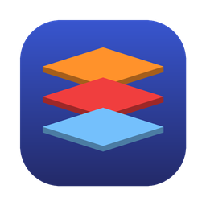

<div align="center">



# MidDeck

**一个客户端，管好你所有的中间件。**
Kafka · Redis · RabbitMQ —— 穿透堡垒机、可视化运维、AI 辅助。

[](https://github.com/YunMuZhe/MidDeck/actions/workflows/build.yml)
[](https://github.com/YunMuZhe/MidDeck/releases)
[](LICENSE)


简体中文 | [English](README.en.md)

</div>

---

## 为什么做 MidDeck

- 发布时新增 Kafka topic、RabbitMQ 队列，每次都要手敲命令；
- 服务上线后想看一眼数据，又得登堡垒机敲命令；
- 现有工具要么只支持一种中间件，要么连不上堡垒机后面的集群，要么不好用。

MidDeck 是一个跨平台桌面客户端，把常用中间件的日常操作做成可视化界面，并且**认真解决了"连不上"的问题**。

## 功能

### 连接与网络
- **多级 SSH 跳板 + SOCKS5 代理**：密码 / 私钥 / ssh-agent 认证，所有连接从最后一跳发起
- **跳板机统一维护**：跳板机集中管理，新建连接时直接选用（也可当场新建），改一处所有连接同步生效
- **Kafka 内网地址自动可达**：broker 通告的 `advertised.listeners` 是内网地址也能用；还支持地址映射
- **分层连接诊断**：SSH → TCP → TLS → 认证 → broker 可达性 → 版本 → 权限，逐层告诉你哪一步出问题、怎么修
- **版本兼容性检测**：连接后自动识别服务端版本，不兼容或功能受限时给出提示（[支持矩阵](docs/COMPATIBILITY.md)）

### 配置管理
- 按 **项目 → 环境 → 实例** 组织，支持别名、标签、模糊搜索
- 密码存入系统钥匙串（macOS Keychain / Windows 凭据管理器），不落盘
- **导入导出**：默认不含密码；也可以用口令加密（AES-256-GCM）整包分享给同事

### Kafka
- Topic：列表、详情（分区 / ISR / offset / 配置）、创建、删除、扩分区、修改配置
- 消息：按最新 / 最早 / offset / 时间点查询，按 key 和内容过滤，JSON 格式化，导出 JSONL，发送消息（含 header、指定分区）
- 消费组：Lag 总览与分区明细、**重置 offset（先预览再执行）**、删除
- **消息跳过与回放**：把消费组卡住的消息先保存到本地，再移动 offset 越过它们；修复后一键回放到原 topic（或重试 topic、其他集群），每条消息带上 `x-middeck-replay` 等回放标记 header

### Redis
- 单机 / 集群 / 哨兵；基于 `SCAN` 浏览 key（不会执行 `KEYS`）
- string / hash / list / set / zset / stream 查看，string 编辑，TTL 管理，批量删除
- 命令行控制台：历史记录，危险命令二次确认
- INFO 概览、慢日志；检测被禁用或改名的命令（`rename-command`）
- 识别 Valkey / Dragonfly / KeyDB 等兼容实现

### RabbitMQ
- 队列 / Exchange 列表，新建队列（classic / quorum / stream，死信、TTL、绑定一步完成）
- 查看消息（requeue 模式）、发布消息、清空队列、删除队列
- 导出 vhost definitions

### 变更集（Kafka / RabbitMQ）
- 用 YAML 描述 topic、exchange、队列、绑定，**plan 预览差异 → apply 执行**；只处理文件中列出的资源，删除需显式开启
- 从任意连接导出现状，对另一个连接 plan，即完成 **跨环境推广**；`envs` 支持按环境覆盖副本数、分区等
- 同一个二进制就是 CLI：`MidDeck changeset plan|apply|export`，可接入 CI，详见 [docs/CHANGESETS.md](docs/CHANGESETS.md)

### AI 助手（⌘K / Ctrl+K）
- 一句话定位实例并打开预填好的表单，例如“在生产订单 Kafka 上建 topic order-refund，12 分区，保留 7 天”
- 支持 **Anthropic 协议**（默认 `claude-opus-5-5`）和 **OpenAI 兼容协议**（OpenAI、DeepSeek、通义千问、Ollama 等）
- **只预填、不执行**：每一步都需要你在表单里确认；模型只能看到名称、项目、环境、标签、别名和描述，看不到密码

### MCP Server
- `MidDeck mcp` 以 MCP Server 运行，在 Claude Code、Cursor 里直接查 topic、消费积压、Redis key、RabbitMQ 队列
- 复用 MidDeck 已保存的连接、跳板机和钥匙串凭据；**只读**，写操作仍在 App 内完成
- 配置方法：左下角设置 → “在 Claude Code / Cursor 中使用（MCP）”，或见 [docs/MCP.md](docs/MCP.md)

### 界面
- 中文 / English 切换（默认英文），浅色 / 深色 / 跟随系统
- 首页总览与每个实例的指标卡片（Topic、Lag、内存、待消费消息等）

### 安全
- 生产环境醒目标识；危险操作需要输入资源名确认
- 实例级 **只读模式**
- 所有写操作记录到本地**审计日志**
- 表单旁显示**等价 CLI 命令**，一键复制

## 安装

到 [Releases](https://github.com/YunMuZhe/MidDeck/releases) 下载对应平台的安装包：

| 平台 | 文件 |
|---|---|
| macOS（Intel + Apple Silicon） | `MidDeck-*-macos-universal.dmg` |
| Windows x64 / ARM64 | `MidDeck-*-windows-*-setup.exe`，或免安装的 `*-portable.exe` |
| Linux x64 | `MidDeck-*-linux-amd64.tar.gz`（需要 `libwebkit2gtk-4.1`） |

> 安装包暂未签名，首次打开时 macOS / Windows 会弹出安全提示，处理方法见 [安装说明](docs/INSTALL.md)。

## 路线图

- [x] 连接管理、SSH 跳板、分层诊断、版本兼容性检测
- [x] Kafka / Redis / RabbitMQ 基础运维
- [x] **变更集**：用 YAML 描述 topic / 队列，plan → apply，跨环境推广，CLI 可接入 CI
- [x] **消息跳过与回放**：导出卡住的消息 → 移动 offset → 修复后回放（附带回放标记 header）
- [x] **AI 助手**：支持 OpenAI 兼容协议与 Anthropic 协议，一句话定位实例并预填表单（只预填，人工确认后执行）
- [x] MCP Server：在 Claude Code、Cursor 中直接查询中间件
- [x] 跳板机统一维护
- [ ] Agent 模式：堡垒机禁止端口转发时，通过部署在内网的轻量 agent 访问
- [ ] 更多中间件：RocketMQ、Pulsar、Elasticsearch、ZooKeeper、Nacos

欢迎在 [Issues](https://github.com/YunMuZhe/MidDeck/issues) 投票或提出需求。

## 从源码构建

依赖：Go 1.26+、Node.js 20+、[Wails v2](https://wails.io/docs/gettingstarted/installation)。

```bash
go install github.com/wailsapp/wails/v2/cmd/wails@latest
wails dev      # 开发模式，前端热更新
wails build    # 产物在 build/bin/
```

项目结构：

```
internal/
  config/    实例配置、钥匙串、加密导入导出
  tunnel/    SOCKS5 + 多级 SSH 拨号器
  diag/      分层诊断报告
  compat/    版本支持矩阵
  driver/    kafka (franz-go) / redis (go-redis) / rabbitmq (Management API)
app.go       绑定给前端的方法
frontend/    React + TypeScript + Ant Design
```

## 参与贡献

见 [CONTRIBUTING.md](CONTRIBUTING.md)。新增一种中间件，只需要在 `internal/driver/` 下实现连接、诊断和 `Info()`。

## License

[MIT](LICENSE)
